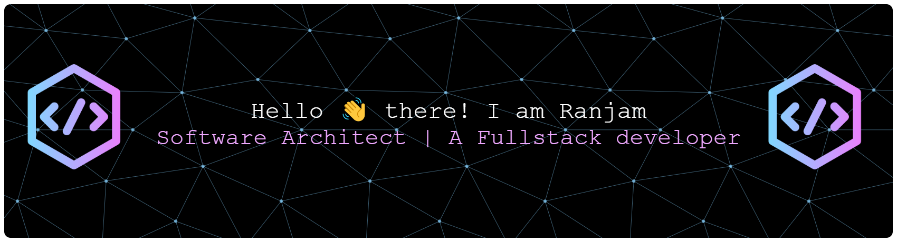

##  Short Intro

### Full-Stack Engineer | React, Next.js, Node.js, .NET Core & Blazor

A result-driven Full-Stack Engineer focused on building scalable, secure, and high-performing software solutions that directly drive business revenue. With deep expertise spanning modern JavaScript/TypeScript ecosystems and enterprise-grade .NET architectures, I bridge the gap between robust backend engineering and seamless, interactive user experiences.

🌍 Open to local & remote opportunities  
✉️ Contact: aly.ranzam@gmail.com

##   Tech Stack & Tooling

| Domain | Technologies |
| :--- | :--- |
| **Frontend** |  |
| **Backend & APIs** |  |
| **Databases & State** |   |
| **DevOps & Cloud** |  |
| **Others**|  |
---

##  Stats

  

##   Let's Connect
- 🌐 **Portfolio & Website:** [ryanzam.is-a.dev](https://is-a.dev)
- 💼 **LinkedIn:** [/in/aramazan](https://linkedin.com)
